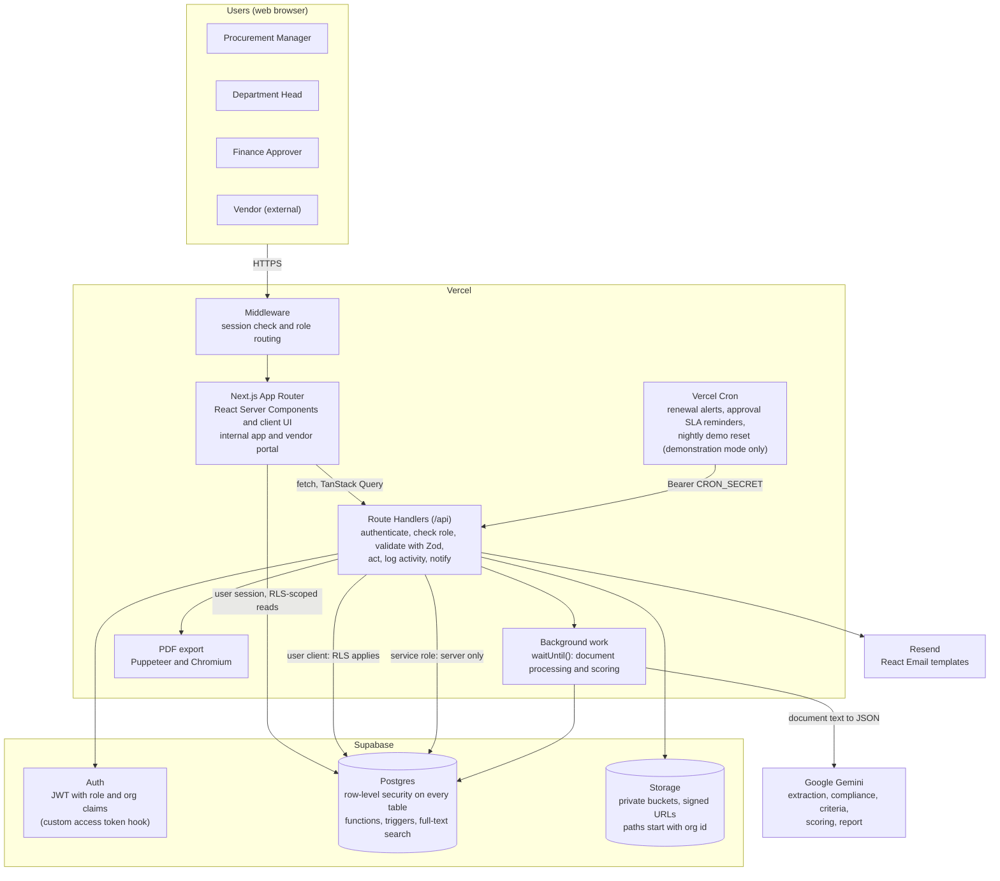
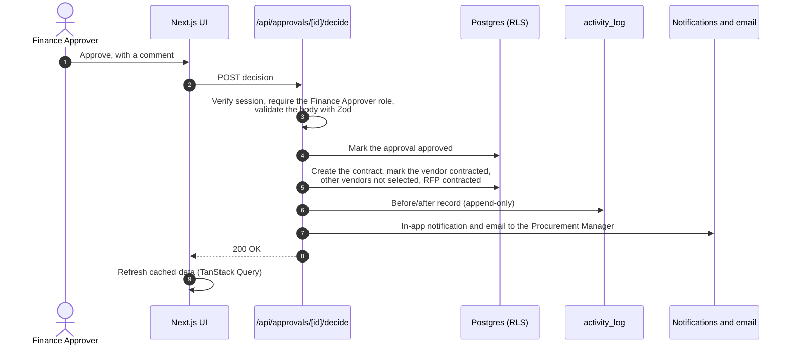
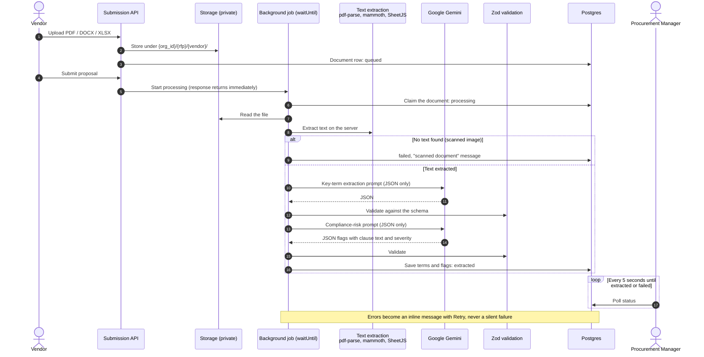
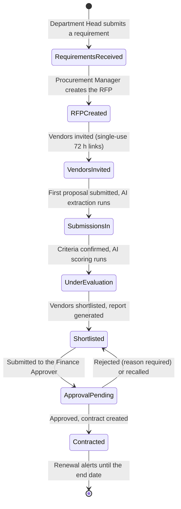
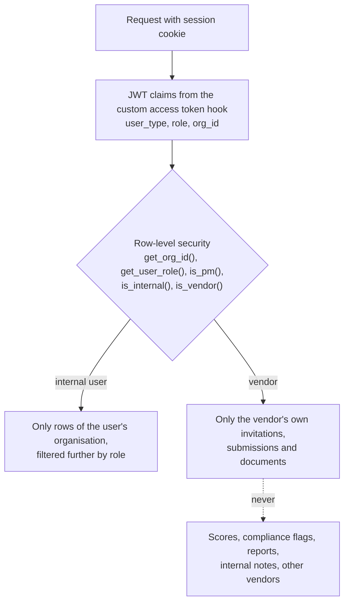
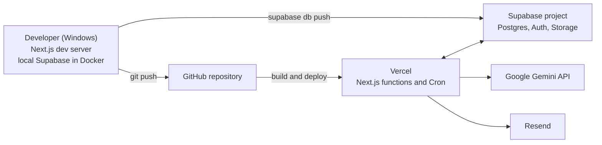

# Architecture and Technology Flow

This document shows how ProcureMaster is built: the overall architecture, how a request flows through it, how the AI pipeline processes vendor documents, the procurement workflow, and how data is kept secure. The diagrams are written in Mermaid, which GitHub renders automatically.

## 1. System architecture

| Layer | Responsibility | Technology |
| --- | --- | --- |
| Presentation | Internal app for three roles, vendor portal, sign-in screens | Next.js 15 App Router, React 19, Tailwind CSS, shadcn/ui, Recharts, dnd-kit |
| Client state | Server data cached and refreshed; small UI state only | TanStack Query, Zustand |
| API | Every change goes through a Route Handler: authenticate → check role → validate → act → activity log → notifications | Next.js Route Handlers, Zod, `{ error, code }` error shape |
| Background processing | Long AI work runs after the response is sent; the UI polls for status | `@vercel/functions` `waitUntil()`, 5-second polling |
| AI | JSON-only prompts, answers validated before storage, retries and model fallback | Google Gemini via `@google/genai` |
| Data | Multi-tenant Postgres with row-level security, triggers and functions | Supabase Postgres, 35 versioned migrations |
| Identity | Accounts created server-side; role and organisation carried in the JWT | Supabase Auth, custom access token hook |
| Files | Proposals, contracts and attachments in private buckets | Supabase Storage, signed URLs |
| Scheduled jobs | Daily renewal alerts and approval reminders | Vercel Cron and protected API routes |
| Email | Invitations, approvals, decisions, reminders, renewals | Resend, React Email |
| Quality | End-to-end tests of every critical flow, including vendor isolation | Playwright, page-object model |

## 2. Request flow: one state change

Every write in ProcureMaster follows the same path. Here the Finance Approver approves a vendor selection.

## 3. AI document pipeline

When a vendor submits a proposal, each document is processed in the background. The vendor sees "Submitted"; the Procurement Manager's screen updates as each document finishes.

**AI safeguards**
- Document text is extracted on the server; files are never sent to the AI as attachments.
- Vendor text is fenced inside randomised delimiters, and the prompt tells the model to treat it as data, so instructions hidden in a proposal can't redirect the AI.
- The model must answer in JSON. Each answer is validated with Zod before anything is written, and invalid answers are rejected and can be retried.
- Calls go through a model chain with retries on rate limits and server errors.
- AI output is advisory: no workflow state ever moves forward because of an AI answer alone.

The same pattern is used for **criteria suggestion**, **scoring** (each vendor against each confirmed criterion, with a justification; the Procurement Manager can override any score) and the **comparison report** (executive summary and advisory recommendation).

## 4. Procurement workflow

The early stages can also be moved by dragging cards on the pipeline board. Approval Pending and Contracted can only be reached through the approval workflow. Any RFP before Approval Pending can be archived; archiving is final.

## 5. Security and multi-tenancy

- **Tenancy:** every table carries `org_id` and has row-level security policies. Same-organisation triggers stop cross-tenant references.
- **Accounts:** created only on the server, through the admin API, with role and organisation in `app_metadata`. Public self sign-up is off. Users can change only their own name and avatar.
- **Vendor isolation:** vendors reach RFP and document data only through dedicated server routes that return the vendor's own data. This is covered by end-to-end tests.
- **Secrets:** the service-role, Gemini, Resend and cron keys exist only on the server.
- **Files:** private buckets; downloads use short-lived signed URLs.
- **Audit:** `activity_log` is append-only and records before/after values for every change.
- **Data lifecycle:** primary records are soft-deleted (`is_deleted`), never removed.

## 6. Deployment

| Environment | Database | AI | Email |
| --- | --- | --- | --- |
| Local development | Supabase in Docker (`supabase start`, `supabase db reset`) | Gemini API | Caught by Mailpit |
| End-to-end tests | Local Supabase, reset before each run | Test stand-in (real Gemini with `LIVE_AI=1`) | Mailpit, checked by the tests |
| Production | Hosted Supabase, migrations applied with `supabase db push` | Gemini API | Resend |

**Demonstration mode (optional).** A deployment can set `DEMO_MODE=1` to add a fictional sample company, one-click demo logins, protection for the shared accounts and a nightly reset. This lets visitors experience the platform as each role. It sits on top of the architecture above and changes nothing when switched off. See the main [README](../../README.md#demonstration-mode-optional).

---

*See [Customer Use Case](customer-use-case.md) for the business story behind the platform.*
